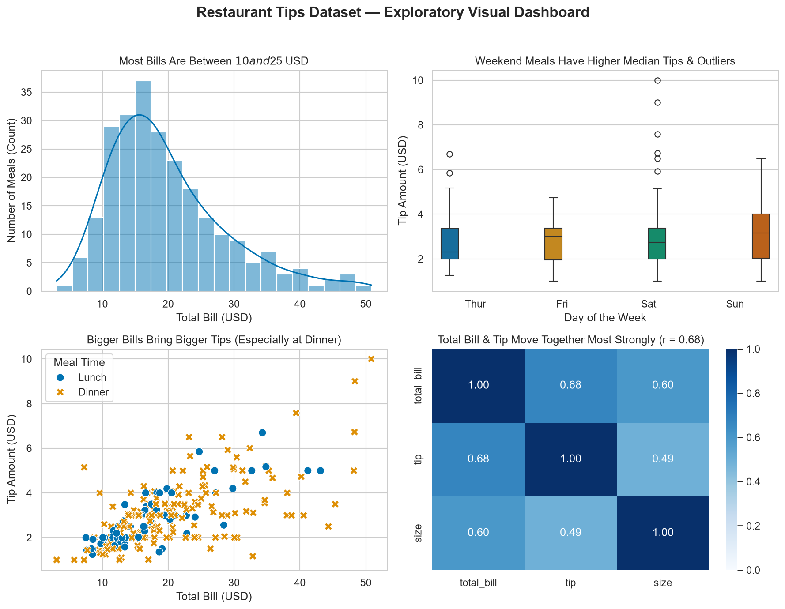

# Data Visualization with Matplotlib & Seaborn (Tips Dataset)

**Internship:** InternCircle — Data Science & AI  
**Project:** 02 — Data Visualization with Matplotlib & Seaborn  
**Author:** Nived Krishna B  

---

## 📌 Project Overview
This project creates clear, honest, and accessible statistical visualizations from the classic `tips` restaurant dataset using Matplotlib and Seaborn. It explores total bill distributions, day-to-day tipping patterns, bill-to-tip relationships across meal times, and numerical correlations, culminating in a high-resolution (150 DPI) 2x2 visual dashboard (`tips_overview.png`).

---

## 🎯 Guiding Questions & Chart Selection
1. **Distribution:** How are total restaurant bills distributed across all meals? *(Histogram with KDE)*
2. **Group Comparison:** Do tip amounts and average tips differ across days of the week? *(Box Plot & Zero-Baseline Bar Chart)*
3. **Bivariate Relationship:** Does a larger total bill bring a larger tip, and how does meal time (Lunch vs. Dinner) factor in? *(Color-coded Scatter Plot)*
4. **Correlation Analysis:** Which numerical variables (`total_bill`, `tip`, `size`) move together most strongly? *(Annotated Correlation Heatmap)*

---

## 📊 Key Visual Takeaways
* **Histogram (Total Bill Distribution):** Most restaurant bills fall between **$10 and $25 USD** (median $17.80 USD, mean $19.79 USD), displaying a right-skewed distribution with rare bills reaching up to $50.81 USD.
* **Box Plot & Bar Chart (Tips by Day):** Weekend diners leave higher tips overall; **Sunday** records the highest average tip (**$3.26 USD**) and median tip (**$3.15 USD**), while **Saturday** exhibits the widest interquartile spread and highest single-tip outliers (up to **$10.00 USD**).
* **Scatter Plot (Bill vs. Tip by Time):** A strong positive linear pattern shows that bigger bills consistently bring bigger tips, with **Dinner** meals accounting for the vast majority of bills over $30 USD and tips over $5 USD.
* **Correlation Heatmap:** The strongest positive linear correlation is between **`total_bill` and `tip` (`r = 0.68`)**, followed by **`total_bill` and party `size` (`r = 0.60`)**, and a moderate correlation between **`size` and `tip` (`r = 0.49`)**.

---

## 🖼️ Visual Dashboard Preview

---

## 💻 Tech Stack & Design Choices
* **Tools:** Python 3.13, Pandas, NumPy, Matplotlib, Seaborn, Jupyter
* **Accessibility:** Uses the `colorblind` and `Blues` palettes to ensure full readability for color-blind viewers (avoiding red-green combinations).
* **Formatting:** Descriptive finding-based chart titles, explicit axis units (`USD`, `Count`), zero-anchored bar charts, and `plt.tight_layout()` exported at **150 DPI**.
